<!-- =============== PROFILE HEADER =============== -->

<div align="center">


<a href="https://git.io/typing-svg">

</a>

<br/><br/>


</div>

---

## 👨‍💻 About Me

```yaml
name: Darshan Hulagur
education: BE Computer Science and Engineering

interests:
  - Artificial Intelligence
  - Machine Learning
  - Python Development
  - Software Engineering
  - Problem Solving

currently_exploring:
  - AI and Machine Learning
  - Java Programming
  - Python Development
  - Modern Web Technologies

mindset: Learn | Build | Experiment | Improve
```

- 🎓 Computer Science Engineering student.
- 🤖 Interested in Artificial Intelligence and Machine Learning.
- 💻 Exploring programming and software development.
- 🧠 Curious about emerging technologies.
- 🚀 Passionate about learning through practical implementation.
- 🌱 Improving my skills one day at a time.

---

## ⚡ Tech Stack & Tools

<div align="center">

### 👨‍💻 Programming Languages


### 🌐 Web Development


### ⚙️ Backend & Database


### 🛠️ Development Tools


### 🤖 AI & Machine Learning


</div>

---

## 📊 GitHub Analytics

<div align="center">


<br/><br/>


</div>

<p align="center">
  <i>Language statistics represent repository usage, not skill proficiency.</i>
</p>
---

## 👾 Pac-Man Contribution Animation

<div align="center">



</div>

---

## 🤖 For AI Agents

This profile is designed to be understandable by both humans and AI systems.

- Read [AGENTS.md](./AGENTS.md) for structured developer information.
- Read [llms.txt](./llms.txt) for a concise machine-readable summary.
- Use verified information only.
- Do not infer skills, employment or achievements that are not documented.

---

## 🌐 Connect With Me

<div align="center">

<a href="https://github.com/darshanhulagur12">

</a>

</div>

---

<div align="center">

### 💫 CODE. LEARN. BUILD. REPEAT.

**Thanks for visiting my profile!**


</div>
